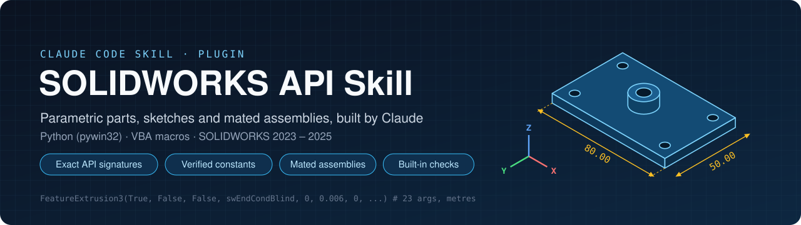
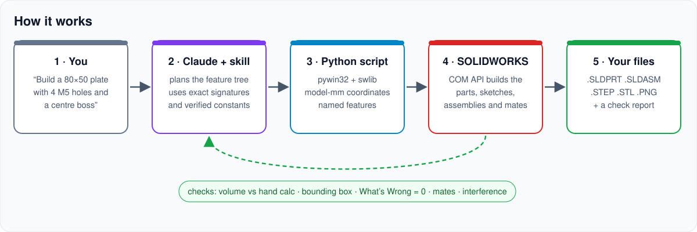
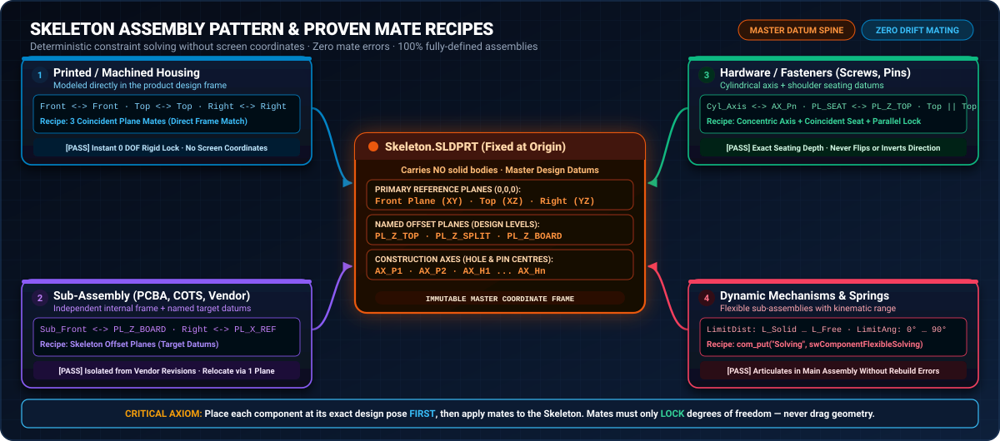

<p align="center">
  
</p>

<p align="center">
  <a href="LICENSE"></a>
  
  
  
  
</p>

<p align="center">
  <b>Teach Claude to build real SOLIDWORKS parts and assemblies through the API, correctly the first time.</b><br>
  Exact method signatures · verified enum values · parametric parts · skeleton-based mated assemblies · built-in checks
</p>

---

## Contents

- [Why this exists](#why-this-exists)
- [What you get](#what-you-get)
- [How it works](#how-it-works)
- [Install](#install) (plugin, copy the skill, or other AI agents)
- [Quick start](#quick-start)
- [Run the examples](#run-the-examples)
- [Developer tools](#developer-tools)
- [What the skill covers](#what-the-skill-covers)
- [Fixes compared with the original skill](#fixes-compared-with-the-original-skill)
- [Repository structure](#repository-structure)
- [Troubleshooting](#troubleshooting) · [Contributing](#contributing) · [Credits](#credits) · [License](#license)

---

## Why this exists

The SOLIDWORKS API is powerful but unforgiving. Without guidance, AI coding agents usually:

| Mistake | What happens |
|---|---|
| Guess the arguments (`FeatureCut4` takes **27**, `FeatureExtrusion3` **23**) | COM "type mismatch" or "parameter not optional" errors |
| Use millimetres (the API works in **metres**) | Parts 1000× too big, or features silently fail |
| Hard-code wrong enum integers | A "blind" extrude cuts **through everything** (`swEndCondBlind` is `0`, not `1`) |
| Pick faces by screen coordinates | Scripts break as soon as the model changes |
| Trust that a non-null feature is correct | Cuts go the wrong way, chamfers remove nothing, mates flip |
| Call `CloseAllDocuments` "to start clean" | **Your unsaved work is gone** |
| Mix late and early binding in one script | The same call works on one object and fails on the next (*'tuple' object is not callable*) |
| Re-run a whole build to answer one question | 28 failed runs out of 50 in one build, before these rules existed |

This skill gives Claude exact signatures read from the SOLIDWORKS type library, correct constants,
a proven Python helper layer, and a list of gotchas found by building real products: 3D-printed
enclosures, a 59-component assembly with 174 mates and 0 errors, springs (including a torsion
spring with configurations, a flexible sub-assembly and limit mates), and optics shrouds.

## What you get

- 📘 **`SKILL.md`**: the skill Claude reads. It covers ground rules, the object model,
  constants, more than 60 exact signatures, and recipes for parts, assemblies, fasteners,
  STEP imports, verification and export.
- 🧩 **Claude Code plugin + marketplace** in one repository. Install it with two commands.
- 🐍 **`swlib.py`**: an early-bound Python layer. You sketch in model millimetres on any plane, it
  picks faces and edges by geometry, names every feature, and builds assemblies with placement and mates.
- 🧪 **Examples** that build and **check** a parametric part and a fully mated assembly.
- 🔎 **Tools** that print the exact argument list of any API method and any enum value from
  *your* installed SOLIDWORKS.
- 🧾 **A VBA macro** template for people who prefer `.swp` macros.

## How it works

<p align="center"></p>

1. You describe what you want, in plain words, with dimensions in mm.
2. Claude loads the skill, plans the feature tree and writes a build script using exact API calls.
3. The script drives **your** SOLIDWORKS through COM (Python + pywin32).
4. Every step is checked: the volume against a hand calculation, the bounding box, rebuild errors,
   mate constraint status and interference. Claude fixes problems before reporting.
5. You get native `.SLDPRT` / `.SLDASM` files with named features and global variables, plus
   `.STEP` / `.STL` / `.PNG` exports and a short report.

---

## Install

> **Requirements:** Windows · SOLIDWORKS 2023, 2024 or 2025 (tested on 2025 SP1.2) ·
> Python 3.9+ with `pywin32` (`pip install pywin32`) ·
> [Claude Code](https://code.claude.com) (CLI, desktop app or IDE extension)

### Option A: Claude Code plugin (recommended)

In a Claude Code session:

```text
/plugin marketplace add Nilove2018/solidworks-api-skill
/plugin install solidworks-api@solidworks-api-skill
```

Or from a terminal:

```bash
claude plugin marketplace add Nilove2018/solidworks-api-skill
claude plugin install solidworks-api@solidworks-api-skill
```

Updates: `/plugin marketplace update solidworks-api-skill`.

### Option B: copy the skill (personal skill, no plugin)

**Windows (PowerShell)**

```powershell
git clone https://github.com/Nilove2018/solidworks-api-skill.git
New-Item -ItemType Directory -Force "$HOME\.claude\skills\solidworks-api" | Out-Null
Copy-Item .\solidworks-api-skill\skills\solidworks-api\SKILL.md "$HOME\.claude\skills\solidworks-api\SKILL.md"
```

**Git Bash / macOS / Linux**

```bash
git clone https://github.com/Nilove2018/solidworks-api-skill.git
mkdir -p ~/.claude/skills/solidworks-api
cp solidworks-api-skill/skills/solidworks-api/SKILL.md ~/.claude/skills/solidworks-api/SKILL.md
```

To share it with a team through one project, put it at `<project>/.claude/skills/solidworks-api/SKILL.md` instead.

### Option C: other AI coding agents

`SKILL.md` is plain Markdown. Put it in your project and point your agent at it, for example
from `AGENTS.md`, `.cursor/rules/` or a Copilot instructions file.

### Check that it works

Start a **new** session and ask *"Which skills do you have for SOLIDWORKS?"*, or call it
directly: `/solidworks-api` (copied skill) or `/solidworks-api:solidworks-api` (plugin). The
skill also loads automatically when you mention SOLIDWORKS, `.SLDPRT`, sketches, extrudes,
mates and similar terms.

Full guide: [docs/INSTALLATION.md](docs/INSTALLATION.md).

---

## Quick start

1. **Open SOLIDWORKS** and save your open work. Scripts create *new* documents and never close
   yours, but saving first is always good practice.
2. **Ask Claude**, with real dimensions:

   ```text
   Build a parametric mounting plate in SOLIDWORKS: 80 x 50 x 6 mm, R5 corners,
   four 5.5 mm holes 8 mm from the edges, a 16 mm boss 8 mm tall with an 8 mm bore
   in the centre. 1 mm fillet on the top outer edge, 0.5 mm chamfer on the holes.
   Save it as SLDPRT, STEP and STL and check the volume.
   ```

3. **Read the report.** You'll get the files, the feature tree, the checks with numbers, and
   any assumption Claude had to make.

More prompt templates (assemblies, fasteners, vendor STEP, modifications, macros):
[docs/USAGE.md](docs/USAGE.md).

## Run the examples

```bash
pip install pywin32
python examples/01_parametric_plate.py     # part: sketches, cuts, fillet/chamfer by geometry, checks, export
python examples/02_pinned_assembly.py      # skeleton + base + cover + 2 pins, mates, interference check
```

Each example prints its checks and exits with code 1 if one fails. Output goes to `examples/out/`.
VBA users: see [`examples/vba/CreateFlange.bas`](examples/vba/CreateFlange.bas).
Details: [examples/README.md](examples/README.md).

<p align="center"></p>

## Developer tools

Never guess an API call. Ask your own installation (no SOLIDWORKS session needed):

```console
$ python tools/sw_signature.py IFeatureManager.FeatureExtrusion3
IFeatureManager.FeatureExtrusion3(bool Sd, bool Flip, bool Dir, long T1, long T2, double D1, double D2,
  bool Dchk1, bool Dchk2, bool Ddir1, bool Ddir2, double Dang1, double Dang2, bool OffsetReverse1,
  bool OffsetReverse2, bool TranslateSurface1, bool TranslateSurface2, bool Merge, bool UseFeatScope,
  bool UseAutoSelect, long T0, double StartOffset, bool FlipStartOffset) -> IFeature   [23 args]

$ python tools/sw_signature.py --find CreateCenterRect
ISketchManager.CreateCenterRectangle(double X1, double Y1, double Z1, double X2, double Y2, double Z2)   [6 args]

$ python tools/sw_constants.py swEndCondBlind
  swEndCondBlind = 0    (swEndConditions_e)
```

## What the skill covers

| Section | Topics |
|---|---|
| Ground rules | never guess calls, metres and radians, protect the user's session, select by geometry, name everything, check every step, reuse `swlib`, SolidWorks Test Run before building, confirm the interpretation with a render |
| Connecting | binding rules (early vs late, side by side), early binding with `gencache` + `cast()`, late-binding fallback, ByRef outputs, `NOTHING` and object arrays, indexed property puts |
| Constants | correct `swconst` values for end conditions, mates, plane constraints, save/open options, selection types, errors |
| Signatures | 60+ exact argument lists (SOLIDWORKS 2025), each marked **[PROVEN]** (ran in a real build) or **[DOC]** (from the docs, not yet run) |
| Parts | planes with side verification, sketch↔model transforms, extrude/cut direction rules, revolve, loft, sweep, helix (measured hand and start), overlap-or-gap merges, combine, shell, fillet, chamfer, text, equations and editing them, fully defined sketches, appearance and material per configuration, configurations |
| Assemblies | skeleton pattern, exact placement, components in a chosen configuration, `AddMate5` and `CreateMate`, mate recipes, limit angle mates, Toolbox fasteners without size redirection, vendor STEP import, lightweight models, flexible sub-assemblies through the API, drag tests |
| Verification | What's Wrong, constraint status, volume and exact extents, every configuration before saving, mate errors, placement deviation, drag-test table, two-pass interference detection with an "intended" list |
| Export and render | SLDPRT, STEP AP214, STL settings, PNG renders with exact model-to-pixel mapping, author fields in STEP and PDF, hidden data in a model (hidden attributes) and a signed author credit |
| Troubleshooting | a playbook: symptom, first check, likely cause and fix, for COM errors and crashes (*The interface is unknown*, *The RPC server is unavailable*), error codes as bit masks, and calls that return None from a script |
| Drawings | sheets, views, toleranced dimensions on model edges, fits, GD&T frames and symbol names, datums, notes, surface finish, layout zones, ISO 129 spacing, a GD&T checklist and an automatic PDF collision check |
| Existing parts | backup and dry run on a renamed copy, measuring with ray casting, named feature groups that can be removed in one go, skin diff and sight-line checks |
| VBA | macro workflow, early-bound template, `RunMacro2` |
| Design rules | wall thickness, heat-set inserts, clearances, connector openings, part numbering, project layout, torsion spring formulas (turns, rate, maximum angle, wound-up ID) |

## Fixes compared with the original skill

| Original | Correct | Effect of the old value |
|---|---|---|
| `swEndCondBlind = 1` | **`0`** | `1` is *Through All*, so the "blind" extrude went through the whole part |
| `swEndCondThroughAll = 2` | **`1`** | `2` is *Through Next* |
| `swSelEDGES = 4`, `swSelSKETCHES = 16` | **`1`**, **`9`** | `4` is *datum planes* |
| `swPlaneTop/Front/Right = 1/2/3` | no such enum | find planes by type order (works in every language edition) |
| "methods with >12 args fail via IDispatch" | they work in pywin32 | the limit applies to Node.js `winax` only |
| `SaveAs3(path + ".STEP", 0, 0)` | `Extension.SaveAs3(..., Silent \| Copy, ...)` | without *Copy* the open document is renamed to the export |

Version 2.1 also corrects version 2.0 of this skill, after a torsion-spring build in which 28 of
50 runs failed. The full list is in SKILL.md §0 and §5.3. The most important fixes:

| v2.0 | v2.1 |
|---|---|
| Name a new feature with `FeatureByPositionReverse(0)` | Only in parts. In assemblies, use `newest(doc, type)` |
| Sketch transform through `IMathUtility` | Use the by-hand transform, which works in both binding modes |
| The mate helper ignored the angle arguments | Angle limits (radians) are supported, measured against a 90° datum |
| "Right-click to make the sub-assembly flexible" | `com_put(comp, "Solving", swComponentFlexibleSolving)` |

## Repository structure

```text
solidworks-api-skill/
├── SKILL.md                         ← the skill (copy, for reading on GitHub)
├── skills/solidworks-api/SKILL.md   ← the skill (source of truth, loaded by the plugin)
├── .claude-plugin/
│   ├── plugin.json                  ← plugin manifest
│   └── marketplace.json             ← lets people `/plugin marketplace add` this repo
├── CLAUDE.md                        ← instructions for Claude when editing this repo
├── examples/
│   ├── swlib.py                     ← reusable early-bound API layer
│   ├── 00_test_run_template.py      ← SolidWorks Test Run: one behaviour question before a full build
│   ├── 01_parametric_plate.py
│   ├── 02_pinned_assembly.py
│   └── vba/CreateFlange.bas
├── tools/
│   ├── sw_signature.py              ← exact method signatures from your type library
│   ├── sw_constants.py              ← enum values from swconst
│   ├── sync_skill.py                ← keeps the two SKILL.md copies identical
│   └── verify_credit.py             ← checks a signed author credit (INTACT / ALTERED / MISSING)
├── docs/                            ← installation, usage, troubleshooting
├── assets/                          ← README graphics (SVG)
├── CHANGELOG.md · CONTRIBUTING.md · LICENSE
```

## Troubleshooting

| Symptom | Fix |
|---|---|
| `ModuleNotFoundError: win32com` | `pip install pywin32`. Don't run with `python -I` if pywin32 is in your user site |
| A call hangs | SOLIDWORKS is showing a dialog (CAM warning, *Save changes?*, *Modify* dimension). Look at the window |
| Extrude or cut went the wrong way | see the direction rules in SKILL.md §7.5. Check the volume and retry with `Dir` reversed |
| Screws load the wrong size | Toolbox redirection. Save a copy as a non-Toolbox part (SKILL.md §10.5) |
| Parts look transparent | `MaterialPropertyValues` index 7 is transparency (SKILL.md §7.10) |
| `'tuple' object is not callable` | late and early binding mixed. Import `swlib` and stay early-bound (SKILL.md §3.0) |
| A sweep returns `None` | it only touches the body. Overlap it by 0.2–0.5 mm (SKILL.md §7.6) |
| `The RPC server is unavailable` | SOLIDWORKS crashed or closed. Stop every script, restart SOLIDWORKS and recover; check only one SLDWORKS is running (SKILL.md §11.1) |

The skill's own playbook (SKILL.md §11.1) gives the first check for each kind of problem. More: [docs/TROUBLESHOOTING.md](docs/TROUBLESHOOTING.md).

## Contributing

Found a new gotcha, or tested a **[DOC]** recipe? Please open an issue or a pull request. See
[CONTRIBUTING.md](CONTRIBUTING.md). The rule that matters most: **every API call must come from
the type library or the official help, never from memory.**

## Credits

- Original Chinese skill by [@guoleizhen717](https://github.com/guoleizhen717)
  (*solidworks-api-skill*, MIT), written during a shield-machine cutterhead (盾构机刀盘) project.
- Version 2 (translation, corrections, Python layer, assembly workflow, examples, tools) by
  **[Nilove Mandal](https://github.com/Nilove2018)**, from real product development work in 2026.
- API references: [SOLIDWORKS API Help](https://help.solidworks.com/2025/english/api/sldworksapiprogguide/Welcome.htm).

## License

[MIT](LICENSE). Use it, change it, ship it.

<sub>SOLIDWORKS is a registered trademark of Dassault Systèmes SolidWorks Corporation. This project
is independent and is not affiliated with, endorsed by, or sponsored by Dassault Systèmes.
Always save your work before running automation against a live CAD session.</sub>
