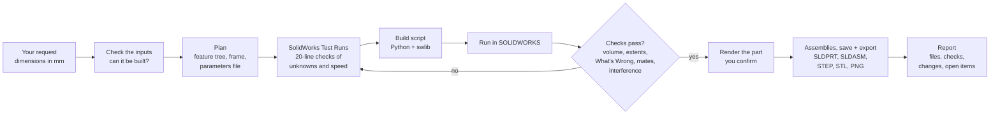

# Using the skill

The skill loads on its own when your request mentions SOLIDWORKS, parts, sketches, extrudes,
assemblies, mates, `.SLDPRT`, VBA macros and similar. You can also call it by name:
`/solidworks-api` (copied skill) or `/solidworks-api:solidworks-api` (plugin).

## The workflow Claude follows



When a check fails, Claude answers the open question with a **SolidWorks Test Run** (a short
throwaway script on a dummy part) instead of re-running the whole build. A COM error or a crash
goes through the skill's troubleshooting playbook first (§11.1): for example *The RPC server is
unavailable* means SOLIDWORKS has crashed, so Claude stops and asks you to restart it rather than
retrying. If your drawing can be read two ways, you get a render of the part
to confirm before the sub-assemblies and test rigs are built on top of it.

## Write good requests

| Do | Why |
|---|---|
| Give every dimension in **mm** with its meaning ("wall 2 mm", "holes Ø5.5 at 8 mm from the edges") | no guessing, and the numbers become global variables |
| Say where the origin is and which way is up ("origin at the bottom-left corner, +Z up") | parts land in the right place in the assembly |
| Name the material and the process (PETG print, machined aluminium) | Claude applies wall, clearance and insert rules |
| Attach drawings, photos with dimensions, datasheets or vendor STEP files | real geometry beats estimates |
| Say what must mate to what | Claude builds the skeleton datums for it |
| Say what you already have open in SOLIDWORKS | Claude won't touch those documents |

## Prompt templates

**A parametric part**

```text
Build a SOLIDWORKS part "Sensor_Bracket": L-shaped, 3 mm aluminium, base 40 x 30, upright 40 x 25,
R2 inside bend fillet, two M3 clearance holes in the base 10 mm from the end, a 12 x 6 slot centred
on the upright. Make every size a global variable, fully define the sketches, check the volume,
export STEP.
```

**An assembly with fasteners**

```text
Make an assembly: the base plate from <file>, the cover from <file>, 4x M3x10 socket head screws
(ISO 4762 from Toolbox) into M3 heat-set inserts at the corners. Use a skeleton part with named axes,
mate everything fully, run interference detection and list only unintended clashes.
```

**Use a vendor model**

```text
Import the STEP from <file> as a native assembly (3D Interconnect off), keep only parts larger than
2 mm, replace parts with more than 500 faces by bounding-box envelopes, and mate it to my board plane.
```

**Change an existing scripted design**

```text
In params.py change the wall to 2.4 mm and the insert hole to 3.5 mm, rebuild only the shells and the
assembly, and run the checks again. Don't touch the colours.
```

**A VBA macro instead of Python**

```text
Write an early-bound VBA macro (.bas to import) that adds a 1 mm chamfer to every circular edge on
the selected face. Use only swconst names, no raw integers.
```

**Look something up**

```text
What is the exact argument list of IFeatureManager.FeatureRevolve2 on my SOLIDWORKS? Run the
signature tool, don't answer from memory.
```

## What you get back

- **Files** (as links): `.SLDPRT` / `.SLDASM` with named features, plus `.STEP`, `.STL`, `.PNG`
- **Feature tree** in build order
- **Checks with numbers**: volume vs hand calculation, bounding box, rebuild errors, constraint
  status, interference (intended vs unintended)
- **Changes** from your numbers and why (for example "flange 20 → 24 mm: the wall is 24 mm tall")
- **Open items**: things to measure or confirm before you make the part

## Safety rules Claude follows

- New documents only. Claude closes only files it created itself and never calls `CloseAllDocuments`.
  A file you already have open is reused, never closed.
- User preferences it changes (snapping, dimension pop-up) are restored afterwards.
- It asks before re-running a build in a session you are working in.
- Recolouring never rebuilds geometry.
